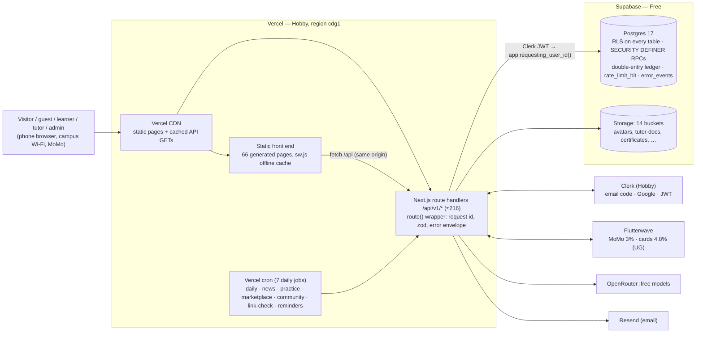
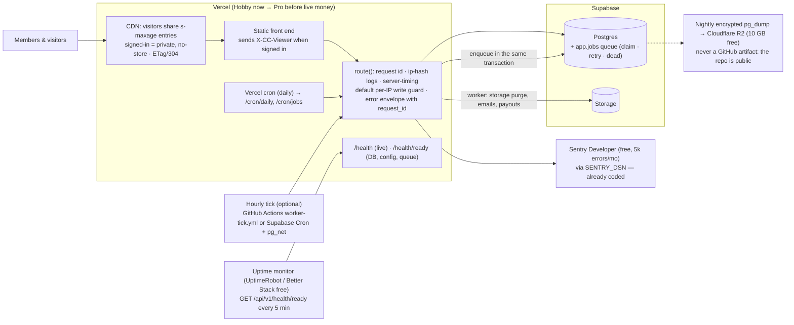
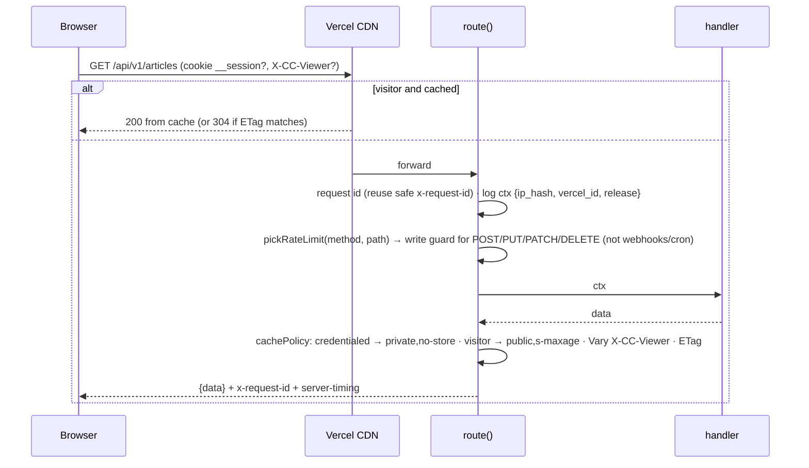
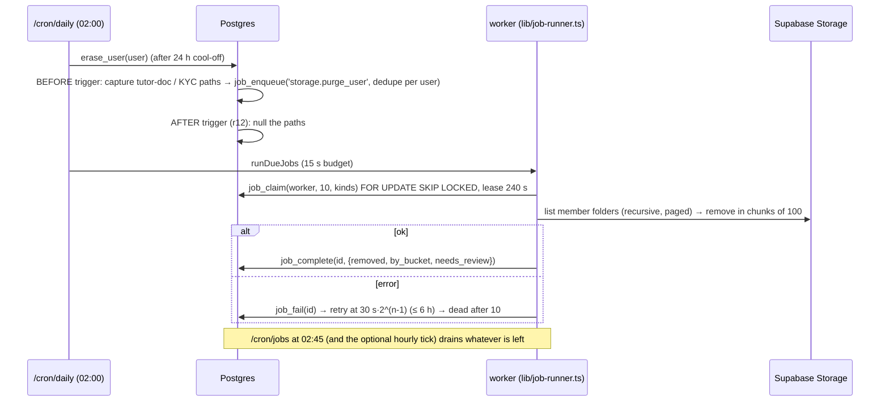

# 101 Codecrafts — architecture (current → target)

Round 13, 6 Nov 2026. Built from three reference images the founder shared (a classic web-app architecture by
moredraw.com, "The $0 AI architecture stack — 2026 edition", "How to build your first team of AI agents"), compared
against what 101 really runs. Every limit below was read on the vendor's own page on 6 Nov 2026 (links inline).
Branches: backend `r13/architecture-api` (off `integrate/round12-api` 2447f5b), front end `r13/architecture`
(off `r12/ui-skills` 9a6d140). Nothing here is deployed, merged or applied.

---

## 1. Today (as built)



What the reference "web app" picture maps to on 101:

| Box in the moredraw picture | 101 today | Gap |
|---|---|---|
| DNS → Web App | Vercel domains | — |
| LB (distributes traffic) | Vercel edge + Fluid compute (managed) | — |
| CDN (cached content) | Vercel CDN for static files; 23 of 123 API GET handlers set `cacheSeconds` | **7 of those GETs answered with the caller's RLS view and cached it publicly** (fixed, §3.1); no ETag; `/assets/*` is `immutable` for 1 year without fingerprinted names |
| Web app servers / backend servers | one Next.js app (route handlers) + Postgres functions | fine at this size |
| Features (full text, auth server) | Clerk; Postgres search | — |
| Broker → Workers (queued background tasks) | **none**: cron jobs do everything inline once a day | §3.3 |
| Database | Supabase Postgres + RLS | **no automatic backups on Free** (§3.5) |
| Cache (quick access) | none besides CDN | not needed yet; Upstash free tier if it is |
| Logging & monitoring | JSON logs to Vercel (Hobby keeps **1 hour**), `error_events` table, optional `SENTRY_DSN` | no request id in logs for writes that fail before the handler, no readiness probe, no uptime monitor (§3.4, §3.6) |
| CI/CD | Vercel git deploys + `backend-ci.yml` (tsc, eslint, unit, DB suite) | front-end tests not in CI |

## 2. Target (free tier first)



## 3. Gaps, fixes and their price

| # | Gap | Done on this branch | Free option (limit, source) | Paid step and cost |
|---|---|---|---|---|
| 3.1 | **CDN can serve one member's RLS view to everyone.** 7 routes call `optionalSession()` and set `cacheSeconds` (`ai-tools`, `articles`, `events/external`, `marketplace/external`, `marketplace/products`, `opportunities`, `practice/contests/:slug/leaderboard`). Web members authenticate by cookie, and cookies are **not** in Vercel's cache key (only an `Authorization` header blocks caching): https://vercel.com/docs/caching/cdn-cache#cacheable-response-criteria | `route()` marks any request with a Clerk `__session` cookie or Bearer token `private, no-store`; visitors keep `public, s-maxage=N, stale-while-revalidate=4N`; `Vary: X-CC-Viewer` and the front end sends that header when signed in, so members never read the visitor entry; weak ETag + 304 on cacheable GETs (saves mobile data) | Vercel CDN, all plans | — |
| 3.2 | **Writes without a rate limit**: 106 of 141 write handlers (webhooks and cron excluded) had no rule (`applications/*`, `events/:id/register`, `conversations/:id/messages`, `marketplace/*`, `me/*`, admin writes, …) | default per-IP guard on every POST/PUT/PATCH/DELETE through `route()` (120/min/IP, generous for campus NAT), specific rules unchanged, webhooks + cron exempt, `Retry-After` on 429 | existing Postgres limiter (`rate_limit_hit`, $0); Vercel WAF rate limiting on Hobby = **1 rule**, fixed window 10 s–10 min, 1M allowed requests: https://vercel.com/docs/vercel-firewall/vercel-waf/rate-limiting; Upstash Redis free 500K commands/mo: https://upstash.com/pricing/redis | per-user limits for signed-in writes (next step, no cost) |
| 3.3 | **No queue / workers.** Hobby cron runs **once a day** (±59 min): https://vercel.com/docs/cron-jobs/usage-and-pricing. Erasure nulls tutor-ID and KYC paths but **never deletes the files** (r12 note in `20261105122000_r12_erase_pii.sql`). Emails are sent inline; Resend Free = **100 emails/day**: https://resend.com/pricing | `app.jobs` table + `job_enqueue / job_claim (SKIP LOCKED, lease) / job_complete / job_fail (backoff 30 s·2ⁿ ≤ 6 h → dead) / job_stats / job_prune` (migration `20261107013000_r13_jobs_queue.sql`, **not applied**); BEFORE trigger enqueues `storage.purge_user` on erase with the paths captured before they are nulled; worker `lib/job-runner.ts` + `/api/v1/cron/jobs` (daily 02:45) and drained again at the end of `/cron/daily` | GitHub Actions on a public repo is free: https://docs.github.com/en/billing/concepts/product-billing/github-actions (`worker-tick.yml`, off until a variable is set); Supabase Cron = pg_cron, any interval, ≤ 8 concurrent, ≤ 10 min each: https://supabase.com/docs/guides/cron; Supabase Queues (pgmq): https://supabase.com/docs/guides/queues; QStash free 1,000 msgs/day: https://upstash.com/pricing/qstash; Vercel Queues (beta) Hobby includes 1,000,000 operations: https://vercel.com/docs/queues/pricing | Vercel Pro $20/mo gives per-minute cron |
| 3.4 | **Observability.** Hobby keeps runtime logs **1 hour**: https://vercel.com/docs/logs/runtime. Request id only on the response | request id sanitised and reused from the client, logs carry `ip_hash` (salted, per day — no raw IP), `vercel_id`, `release`; `server-timing` header; CORS exposes `x-request-id` so the UI can quote it in support | Sentry Developer: 1 user, 5k errors/mo: https://sentry.io/pricing/ (code already posts to it when `SENTRY_DSN` is set); Better Stack free: 100,000 exceptions/mo, 3 GB logs for 3 days, 10 monitors & heartbeats: https://betterstack.com/pricing; Grafana Cloud free, 14-day retention: https://grafana.com/pricing/ | Sentry Team $26/mo |
| 3.5 | **No backups.** Supabase Free: "Automatic backups — Not included", projects pause after 1 week of inactivity: https://supabase.com/pricing; docs say free projects should export their data regularly: https://supabase.com/docs/guides/platform/backups. Storage files are never backed up | — (needs secrets; founder decision) | nightly `supabase db dump` in GitHub Actions, encrypted with `age`, pushed to Cloudflare R2 (10 GB-month, 1M class-A ops free): https://developers.cloudflare.com/r2/pricing/. **Never as a workflow artifact: github.com/101codecrafts/members-site is public** (API `visibility: public`) | Supabase Pro $25/mo = daily backups kept 7 days; PITR +$100/mo |
| 3.6 | **Health checks.** `/health` only pings the DB | `/api/v1/health/ready`: DB round trip, required settings present, queue depth (dead jobs / oldest due > 26 h = degraded); 503 when DB or a required setting is missing; details (setting **names**, never values) only with the cron secret | UptimeRobot free: 50 monitors, 5-min interval: https://uptimerobot.com/pricing/; Better Stack heartbeat for the daily cron | — |
| 3.7 | **Plan fit.** Vercel Hobby "restricts users to non-commercial, personal use only": https://vercel.com/docs/plans/hobby. Hobby functions: 1M invocations, 4 h active CPU, 360 GB-hrs, 300 s max: https://vercel.com/docs/functions/usage-and-pricing, https://vercel.com/docs/limits | — | — | **Vercel Pro $20/mo before any live payment** (founder) |
| 3.8 | **AI capacity.** OpenRouter `:free` models: 20 requests/min; **50 requests/day** with < $10 credits bought, 1,000/day with ≥ $10 (account-wide, not per member): https://openrouter.ai/docs/api-reference/limits | — | Ollama `gemma4:e4b` is 6.6–9.5 GB (needs a machine): https://ollama.com/library/gemma4; HF Docker Spaces now need a paid plan (static Spaces free): https://huggingface.co/docs/hub/spaces-overview | one-off $10 OpenRouter credit → 1,000 free-model requests/day |
| 3.9 | Static `/assets/*` is `immutable` for a year but file names are not fingerprinted | — (front-end owners) | content-hash file names in `tools/build.py` | — |

Other fixed costs to know: Supabase Free 500 MB DB, 1 GB storage, 5 GB egress, 50,000 MAU
(https://supabase.com/pricing); Clerk Hobby 50,000 monthly retained users per app (https://clerk.com/pricing);
Flutterwave Uganda collections: mobile money 3%, local cards 4.8%, international 4.8% (https://flutterwave.com/ug/pricing).

## 4. How a request flows now (`backend/lib/http.ts` + `lib/request-context.ts`)



## 5. Background jobs (`app.jobs`)



Purge scope (decided in code, open to the founder): the member's own folder in `avatars`, `launch-media`,
`post-images`, `project-files`, `tutor-docs`, `certificates`, `data-exports`, plus the captured tutor ID document.
**Not purged:** `course-media`, `listing-files`, `marketplace-private` (buyers keep what they paid for),
`group-files`, `test-*` (owned by a group or campaign). Store KYC files have no bucket recorded anywhere, so they are
reported in the job result as `needs_review` instead of guessed.

Next job kinds that fit this table without new infrastructure: `email.send` (spread over Resend's 100/day),
`payout.disburse` (Flutterwave transfer with the payout id as idempotency key), `certificate.render`.

## 6. AI stack — the $0 picture vs 101

| Layer in the image | Named tools | 101 today | Recommendation |
|---|---|---|---|
| Frontend | Next.js, Streamlit, Vercel free | static pages + Next.js API on Vercel | keep; Streamlit Community Cloud sleeps apps after 12 h idle (https://docs.streamlit.io/deploy/streamlit-community-cloud/manage-your-app) — fine for demos, not the product |
| Agent orchestrator | LangGraph, CrewAI | one-shot calls in `lib/ai.ts` | not needed yet. LangGraph = "low-level orchestration framework and runtime for long-running, stateful agents" (https://docs.langchain.com/oss/python/langgraph/overview); CrewAI hosted Basic = 50 workflow executions/month (https://www.crewai.com/pricing) |
| LLM layer (local) | Ollama Gemma 4 E4B, Llama 3.3 70B, Mistral Small 4 | OpenRouter `:free`; Gemini removed (BUS LG3, under-18 terms) | local models need hardware: llama3.3 70B = 43 GB (https://ollama.com/library/llama3.3); Mistral Small 4 is Apache 2.0 (https://docs.mistral.ai/models/mistral-small-4-0-26-03). Biggest lever is the $10 OpenRouter credit (§3.8) |
| RAG pipeline | Notion, ChromaDB, Qdrant (local) | none | if needed, `pgvector` inside the existing Supabase DB (no new vendor); Qdrant Cloud free 0.5 vCPU / 1 GB RAM / 4 GB disk (https://qdrant.tech/pricing/); Chroma Cloud $5 free credits (https://www.trychroma.com/pricing); Notion API 180 req/min on non-Business plans (https://developers.notion.com/reference/request-limits) |
| Tool use via MCP | GitHub, Slack, DB, files | — | MCP is "an open-source standard for connecting AI applications to external systems" (https://modelcontextprotocol.io/docs/getting-started/intro): dev-side for the agent team, not in the product |
| Code agent | Claude Code CLI, Aider | Hark agents per round | this branch adds AGENTS.md + CLAUDE.md + `.claude/` (front-end repo); Aider = "AI pair programming in your terminal" (https://aider.chat/) reads the same AGENTS.md |
| Data layer | SQLite, DuckDB, Supabase free | Supabase | keep; DuckDB is in-process analytics (https://duckdb.org/why_duckdb) — useful offline for exports, not in the request path |
| Deployment | Docker, Cloudflare Workers, HF Spaces | Vercel | Workers Free 100,000 requests/day, 10 ms CPU (https://developers.cloudflare.com/workers/platform/limits/); Docker Personal $0 (https://www.docker.com/pricing/) |
| Observability | Phoenix (self-hosted) | `error_events`, logs | Phoenix needs a host to run (https://arize.com/docs/phoenix); for AI calls log model, latency and token counts into `ai_usage` (exists) first |

## 7. Agent team (front-end repo, branch `r13/architecture`)

Mapped from the "first team of AI agents" picture onto this repo:

```
AGENTS.md                 rules, commands, definition of done (read by every coding agent)
CLAUDE.md                 @AGENTS.md + Claude-specific notes
.claude/settings.json     permissions (deny push to main, promote/alias, env, db push, .env reads, ai-mascot.js) + hooks
.claude/hooks/
  session-start.sh        load context + goals (branch, dirty files, rules digest, MEMORY tail)
  pre-tool-use.sh         check scope before action: blocks ai-mascot.js, generated root pages, .env, sw VERSION bump
  post-tool-use.sh        review output: node --check / JSON parse on the edited file, build reminder
  stop.sh                 clean exit: runs tools/agent-check.sh, exit 2 sends the agent back to fix
.claude/agents/           planner · researcher · builder · reviewer (router = the main session)
.claude/MEMORY.md         cross-session learnings (short, dated, no secrets)
tools/agent-check.sh      the one gate: JS/JSON parse, build idempotent, CSP current, guard files, key-shaped strings, tests
```

Hook behaviour follows the Claude Code reference (exit code 2 blocks / feeds stderr back; `${CLAUDE_PROJECT_DIR}`):
https://code.claude.com/docs/en/hooks; subagent frontmatter (`name`, `description`, `tools`, `disallowedTools`,
`model`): https://code.claude.com/docs/en/sub-agents; Claude Code reads `AGENTS.md` when no `CLAUDE.md` exists, so
`CLAUDE.md` imports it: https://code.claude.com/docs/en/memory; format: https://agents.md/.

## 8. Founder decisions this needs
1. Apply migration `20261107013000_r13_jobs_queue.sql` (after `20261106030000_r12_event_review`).
2. Purge scope on erasure: confirm paid content (course videos, products) stays for buyers; name the KYC bucket.
3. Move Vercel to Pro ($20/mo) before live money (Hobby is non-commercial).
4. Backups: Supabase Pro ($25/mo) or the free nightly encrypted dump to R2 (needs an R2 bucket + `age` key as secrets).
5. Turn on Sentry (`SENTRY_DSN`) and an uptime monitor on `/api/v1/health/ready`.
6. One-off $10 OpenRouter credit (50 → 1,000 free-model requests/day for the whole site).
